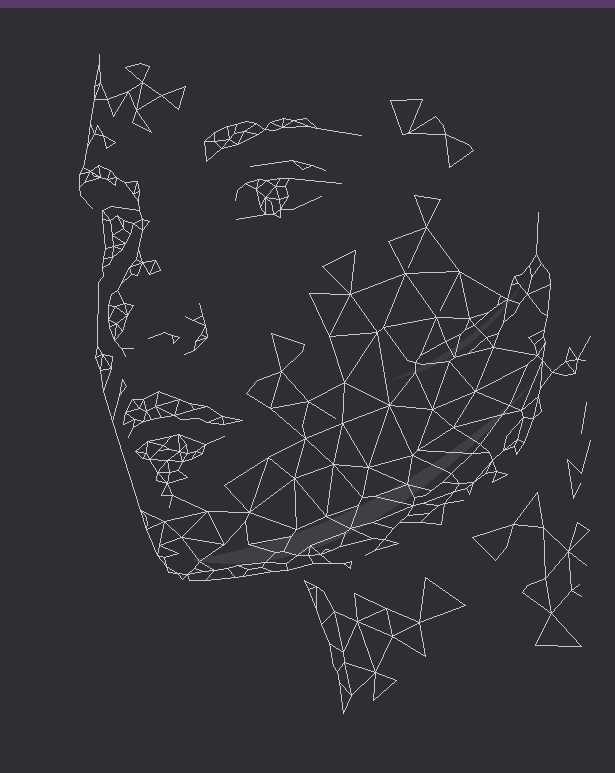

# Vertex Portrait — Low-Poly Wireframe Face

A procedural, coordinate-driven recreation of a low-poly wireframe 3/4 face portrait of a woman. 

Everything in this repository is drawn from deterministic, hand-written vector coordinates and planar geometry without loading, tracing, or auto-converting external images at runtime.



---

## Features

- **Exact 3/4 Facial Geometry**: 
  - Triangular forehead mesh and temple clusters.
  - 3/4 profile left eye, eyelids, and eyelashes.
  - Right eye with upper/lower lids and a circular 6-spoke iris fan.
  - Faceted nose bridge, tip, and nostril contours.
  - Lips with defined Cupid's bow and volumetric polygonal shading.
  - Full organic Delaunay triangulation spanning the cheek and jawline.
  - Neck and collar ribbons tapering toward the bottom edge.
  - Perimeter floating polygonal fragments and shards.
- **Dual Translucent Crescent Highlights**:
  - Smooth curved highlights along the jaw contour and cheekbone (`rgba(255, 255, 255, 0.08)`).
- **Multi-Platform Support**:
  - **Browser (HTML5 Canvas + TypeScript)**: Interactive web app with progressive line animation, print stylesheet integration (`@media print`), and PNG export.
  - **C99 Standalone Program**: Pure C99 with Bresenham line rasterizer and polygon scanline fill, exporting 24-bit uncompressed RGB BMP (`face.bmp`) and binary PPM P6 (`face.ppm`).
  - **Direct Terminal Vector Renderer**: High-definition terminal line art using Unicode Braille patterns (2×4 subpixel dot resolution) and ANSI truecolor.

---

## Terminal Wireframe Preview

```text
================================================================================
        LOW-POLY WIREFRAME FACE PORTRAIT (VECTOR TERMINAL RENDER)               
================================================================================

⠒⠒⠒⠒⠒⠒⠒⠒⠒⠒⠒⠒⠒⠒⠒⠒⠒⠒⠒⠒⠒⠒⠒⠒⠒⠒⠒⠒⠒⠒⠒⠒⠒⠒⠒⠒⠒⠒⠒⠒⠒⠒⠒⠒⠒⠒⠒⠒⠒⠒⠒⠒⠒⠒⠒⠒⠒⠒⠒⠒⠒⠒⠒⠒⠒⠒⠒⠒⠒⠒⠒⠒⠒⠒⠒⠒⠒⠒
                                                                              
            ⢠                                                                 
            ⣸   ⠲⡉⢱⠂                                                          
            ⡿⡄ ⢀⣀⢬⠧⢄⡀⢀⣀⢤                                                      
            ⡗⠺⣊⠝⠱⣸⡠⠔⠊⠣⢤⠃                         ⢖⠒⠒⢒⠆                        
           ⢸  ⠋ ⢠⡓⡄          ⢀⣀⣀⣀ ⣀⢤⣤⢤⡤⣀         ⠘⡄ ⡜⢀⠤⢢                      
           ⣜⠷⣄⡀  ⠈⠙⠂      ⡠⡖⢙⡽⡴⣪⠥⠝⠒⠋⠉⠉⠉⠉⠉⠑⠒⠒⠢⠤    ⠱⠴⠷⠥⠤⠤⡧⣀⡀                   
           ⡏ ⠘⠊          ⠸⡉⡹⠛⠊⠉                         ⢣ ⢈⡱                  
          ⡸⣀⣠⢄⡀           ⠋    ⠠⠤⠒⠒⠒⠉⠹⣒⠤⢄⡀              ⠸⠒⠁                   
          ⡯⠧⠛⠚⢾⠤⡤⢤            ⢀⢤⣲⡖⢖⣖⡖⠒⠒⠒⠤⠤⠤⠄                                  
          ⠣⡀    ⠈⢻           ⠰⠁ ⠘⣦⡯⡦⡞ ⢀⡠⠔           ⢖⠒⠤⡤                      
           ⠈ ⣶⡩⣉⡒⢚⡄          ⢀⣀⣀⠤⠽⠵⣼⠒⠊⠁             ⠈⡆⡰⠁            ⡆         
             ⡇⣇⠽⣨⠓⡟⠁                               ⣀⠤⡺⢅            ⢀⠇         
             ⣇⡯⣳⠃⢰⠁                         ⢀    ⢲⠉ ⢰⠁⠈⠢⡀          ⢸          
             ⣷⠋⠁⢠⡫⣦⢤⡀                   ⢀⡠⠔⠊⢹     ⢣⢠⠃   ⠈⢆        ⢀⢎⢆         
            ⢀⠇ ⡰⠝⠚⠈⠓⠁                    ⠑⢄ ⡎   ⣀⠤⢔⢷⠒⠒⠒⠉⠉⡹⢗⠢⢄   ⢀⣔⠉⡎⠈⢆        
            ⢸ ⡜⡄                       ⡤⠤⠤⠤⠵⣧⠒⠊⠉  ⡎ ⠑⡄  ⡰⠁⢸  ⠉⠒⣄⣜ ⡻⡔⠒⢹        
            ⡸⢸⡖⠾⡵⠂       ⢣             ⠘⡄  ⡜⠈⠢⡀  ⡸   ⠈⢢⠰⠁ ⠈⡆⢀⣀⠜⢩⠃⡝ ⠱⣀⡇        
            ⡇⠸⣶⢽⠁      ⠈⠒⢫⡆             ⠘⡄⡜   ⠑⡄⡰⡥⠔⠒⠒⠊⢩⢫⠉⠉⢩⡻⡓⠁ ⡸⠉   ⢰⠁        
            ⡇ ⠹⡃  ⠐⠒⠉⠒⡖ ⢠⡾⠃       ⢫⠒⠢⠤⣀  ⠸⡒⠒⠒⠉⢉⠿⡀⠑⡄  ⢀⠇⣈⢦⢲⠃ ⡨⢲⡺⠁  ⠐⢎⣽     ⡔   
            ⣯⢦⡄⠙⠍⠁     ⠒⠉         ⠈⡆ ⡠⠃   ⢣  ⡠⠃ ⡇ ⠈⢆⣀⠞⠊⣀⣈⠮⠔⠚⠒⢩⠋⠑⠒⠒⠢⡼⣹  ⣜⣆⣎    
            ⢸⢒⠇                  ⢀⣀⢵⡊      ⢇⡔⠁  ⢱   ⣸⠉⠉ ⡎⠑⢄ ⢀⠎ ⢀⡠⢔⠎⢠⡻⡣⢎⣈⠾     
             ⡟ ⣼⠂   ⣀          ⡠⠊⠁⢀⠇⠈⠢⡀ ⢀⡠⠔⢺⠒⠤⣀ ⠸⡀⢠⠊ ⢣ ⡸  ⠈⢢⣼⠔⠊⠁⢀⠎⢠⠃⡟         
             ⢱⢠⠃⡰⣶⣖⡹⣥⠝⡲⠢⣤⡤⢄    ⠈⠑⠤⣜⡠⠤⠤⢚⠮⢅  ⡜   ⢉⡲⡷⠥⠤⣀⣀⣣⡣⠤⠒⢉⠝ ⠉⠒⢢⠮⣠⠧⢲⡇    ⢀⠆   
             ⠈⡎⢠⡻⣤⠮⠦⠓⠛⠳⠭⠒⠢⠤⣝⣖⡢⠤   ⠈⠒⢄ ⡜  ⠉⢂⣇⠤⠒⠊⠁⡸⠘⡄   ⡎⠑⢄⢠⣊⡠⠤⠔⢲⠋⠉⣠⢗⠗⠁    ⡸    
              ⠸⡀⠔⠁⢀⣀⡠⡤⢴⡦⢄⡀ ⣀⠄        ⢉⣳⡔⠒⠉⢡⠛⢄  ⢠⠃ ⠘⡄ ⡜⢀⡠⠒⠙⠢⢄⡀⡔⠁ ⡔⡝⡸      ⠃⢀   
               ⢇ ⢴⡽⣈⠯⢒⡺⡾⣤⡾⠉       ⡠⠔⠊⠁⡇⠈⠢⡀⡸ ⠈⢆ ⡜   ⢘⣴⠷⠥⠤⠤⠤⠤⡤⠮⠦⣀⡸⠞⡿⠁      ⢀⠎   
               ⠘⡄ ⠉⠹⣹⣫⣩⠋⠁     ⢀⡠⠒⢹⠉⠢⡀⢸ ⣀⡠⠜⡷⡒⠢⠤⢷⢕⡒⠊⠉⢁⠇⠉⠒⠢⢄⡠⠊ ⢀⣴⣣⡀       ⢸⠢⡜    
                ⢱  ⠘⠺⡮⠒⠉    ⢔⠊⠁ ⢠⠃ ⢀⠬⡷⡉  ⢰⠁⠈⢆ ⡇ ⠈⢉⣒⢼⢄⣀ ⡠⠮⢼⣤⣤⠊ ⠮⠚⠁      ⠈⣆⠄    
                ⠈⡆  ⠘⢺⠢⢄⡀    ⠑⢄ ⡎⡠⠒⠁ ⢇⠈⢆ ⡸  ⢀⡝⠒⠒⠫⠥⠤⣀⣗⣒⣯⣔⣺⡩⠤⠃      ⢠⠺⡀   ⠏     
                 ⠘⣦⠤⣀⣈⠤⠤⠬⡳⢲⠒⠒⠒⠒⡟⠫⠤⣀⡀ ⢸ ⢀⡱⢧⡒⠊⢱⠁  ⣀⠤⠒⡹⠥⢲⠊⢠⠃        ⡔⠁ ⢇         
                  ⠸⡊⡝⠑⢢⣠⡊  ⢣ ⡠⠊⢣   ⢈⣉⠞⠊⠁ ⢀⣈⢵⠳⢖⡉⠉⠑⡖⠊⠉⠉⠉⠉⠉   ⢀⡠⠤⠔⠒⡹⠉⠑⠒⢺⢄  ⡜⢒⠄   
                   ⠱⡷⢍⡁⠘⡌⠉⠉⡲⠋  ⠘⠲⠭⣉⣡⣃ ⡠⡶⣉⢅⡠⠧⠔⠒⠊⣩⠯⠕⠂         ⠑⢄ ⢀⠇   ⢸ ⠑⢤⠗⠁    
                    ⠱⡖⠉ ⢘⢔⡉ ⣀⣀⣀⣀⢤⣤⠧⠤⡔⣋⣉⠽⠭⠧⠤⢤⡄ ⠉               ⠑⠁    ⢸ ⡔⢹⠑⠢⡀   
                     ⠉⠓⠖⠯⠭⠽⠭⠤⠧⠔⠛⠓⠉⠉⠉⠉ ⢠⣀             ⢠⣀            ⢀⣸⠊  ⡇⡀    
                                       ⢗⡗⡄  ⢠⢄⡀      ⢸ ⠑⠤⡀        ⠪⡁⠈⡆ ⡠⠫⠄    
                                       ⠈⡇⢘⣄⡀⠘⡄⢈⡩⠶⡢⢄⡀ ⡇ ⢀⡠⠬⠓        ⠈⠑⢵⠜       
                                        ⠸⡁⢱⠈⢱⢟⠥⢄⣀⢇⢀⡨⠕⡗⠉⠁            ⢠⠃⠑⢄      
                                         ⢱⣘⣤⠃⠈⡆  ⡝⠓⢄⡀⢱             ⢠⣃⣀⣀⣈⣢⡀    
                                         ⠈⡆⢣⡀ ⠸⡀⡸   ⠈⠙                        
                                          ⢱⠹⡈⠑⢒⣵⢅⡀                            
                                          ⢸⠢⡧⠔⠁⡜⣀⠜⠁                           
                                           ⡷⠁  ⠋                              
                                           ⠁                                  
```

---

## Quickstart

### 1. Terminal Wireframe Vector Print
Print the portrait directly in your terminal at any time:
```bash
npm run print
```

### 2. Interactive Web Application
Start the local Vite dev server:
```bash
npm run dev
```
Open [http://localhost:5173/](http://localhost:5173/) in your browser.

To create an optimized production build:
```bash
npm run build
```

### 3. C99 Native Compilation
Compile and run the standalone C rasterizer:
```bash
gcc -O2 -o face.exe face.c canvas.c draw.c -lm
./face.exe
```
This writes:
- `face.bmp` (615×773 24-bit uncompressed RGB)
- `face.ppm` (615×773 binary PPM P6)
- And streams the Braille wireframe directly to `stdout`.

---

## Technical Specifications

- **Dimensions**: 615 × 773 px
- **Background**: `#2F2E33` (`RGB: 47, 46, 51`)
- **Accent Top Bar**: `#5A3A6A` (`RGB: 90, 58, 106`, height: 8px)
- **Wireframe Stroke**: `rgba(215, 215, 220, 0.90)` (1px width)
- **Highlights**: Soft quadratic Bézier crescent shapes at `rgba(255, 255, 255, 0.08)`
- **Topology**: 488 active vertices, 773 planar edges, and 174 verified triangles.

---

## License

MIT
